# 이윤제 포트폴리오

## 1. SAP KDT 심화 2기 - RAP 개인 프로젝트

RISE 시리즈 스마트폰 Set을 전국 지점을 통해 판매하는 가상 기업 'S-Mobile'을 배경으로, S/4HANA 전환에 앞서 구매 프로세스를 검증하기 위한 프로토타입을 RAP으로 설계·구현한 개인 프로젝트입니다.

| 구분    | 내용                                                              |
| ----- | --------------------------------------------------------------- |
| 개발기간  | 2026.07 ~ 2026.09 (SAP KDT 심화 2기 프로젝트)                          |
| 프로젝트명 | S-Mobile 구매 프로세스 구축 프로젝트 (자재·공급업체·PIR·구매오더·FI계정·회계결정)             |
| 개발환경  | SAP BTP ABAP Environment, RAP(Managed, V2/V4 OData), CDS View, Fiori Elements |
| 개발인원  | 개인 프로젝트                                                         |
| 담당역할  | 6개 프로그램 설계 및 구현 - DB Table / CDS View / RAP Behavior / Fiori Elements 화면 |

### 핵심 프로세스 흐름

**자재·공급업체 등록 → G/L 계정 & 계정결정 규칙 설정 → 구매정보레코드(PIR) 등록 → 구매오더(PO) 생성·승인**

* 기준정보 등록부터 구매오더 승인까지 하나의 흐름으로 연결
* 구매정보레코드(PIR)가 존재하면 등록된 구매단가·통화 등 구매조건이 PO에 자동 반영되며, PIR이 없는 경우에는 PO 작성 시 구매조건을 직접 입력
* 사전에 등록한 계정결정 규칙(BSX·WRX·PRD)은 이후 물류 트랜잭션에서 회계 지식 없이도 G/L 계정이 자동으로 결정될 수 있도록 준비해 둔 기준정보

### 자재관리 (Material Master)

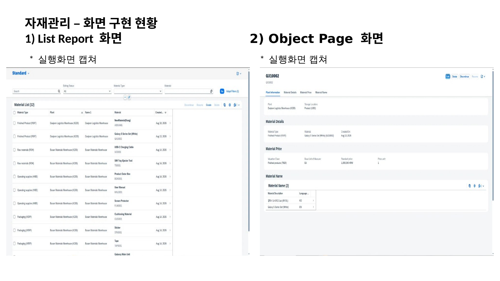

* 원자재부터 완제품까지 자재 기준정보를 통합 관리, 평가클래스 기반 재고·회계 연동
* 자재유형별 기준정보 등록 및 다국어(KO/EN) 자재명 관리
* FS에 없던 LVORM(사용중지) 필드를 신규 추가해, 사용중지(Discontinue) 처리 시 자재명 등 다른 입력 필드 전체를 Read-only로 잠그도록 구현

### 공급업체관리 (Vendor Master)

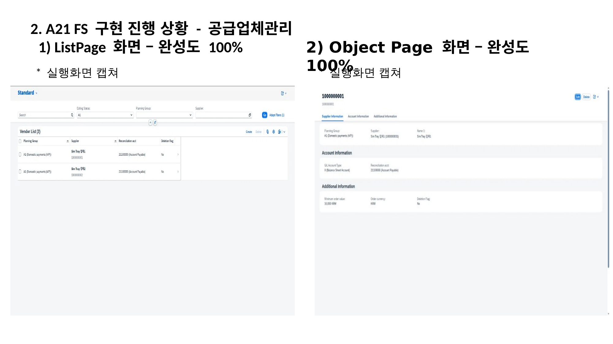

* 벤더분류(국내·해외·계열사 등)별 공급업체 등록 및 관리
* 매입채무가 총계정원장에 반영되도록 조정계정(Akont)을 연결하고, 선택 시 계정유형(Glact)을 Association으로 함께 조회
* 공급업체 분류(A1~A6)마다 시작 번호대를 다르게 하는 Number Range 채번 로직 구현
* 거래정지(Loevm) 체크 시 나머지 입력 필드가 Read-only로 전환되는 동작은 자재관리와 동일한 패턴이며, 별도 액션 없이 값 저장만으로 즉시 잠기도록 처리

### 구매정보레코드관리 (Purchasing Info Record)

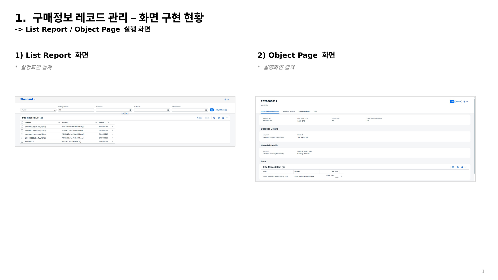

* 반복 거래하는 공급업체-자재-플랜트 조합의 구매단가·최대구매수량·예정배송일수를 사전 등록해 PO 생성 시 자동 반영
* 정보텍스트(Txz01) 필드를 신규 추가해 Object Page 부제목으로 활용
* 자재관리(LVORM) 상태를 실시간으로 연계 체크해, 이미 사용중지된 자재를 참조하는 정보레코드는 수정 자체를 차단 (크로스 모듈 연계)

### 구매오더관리 (Purchase Order)

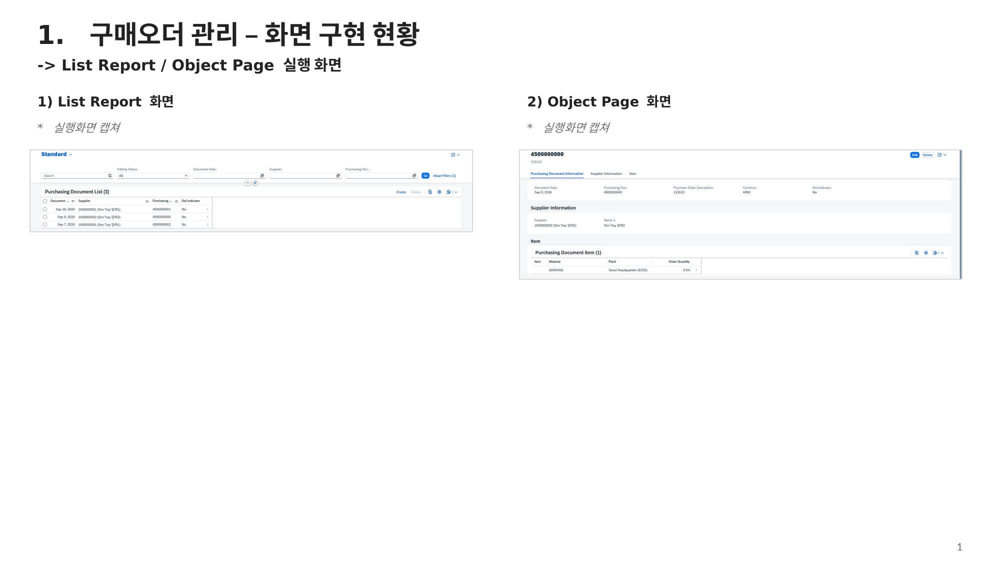

* 구매정보레코드(PIR)를 참조해 구매오더를 생성하고, 아이템 순번(Ebelp)을 10단위로 자동 채번
* 생성일(Bedat)을 시스템 날짜로 자동 설정
* 삭제(Loekz) 상태에 따라 필드를 동적으로 잠금·복구 - Del.Indicator 체크 시 나머지 입력 필드가 Read-only로 전환되고, 체크 해제 시 다시 복구
* 헤더→아이템 삭제 상태를 Side Effects·LINK로 실시간 전파해, 저장 없이도 관련 필드를 즉시 잠금 처리

> **트러블슈팅 - 품목번호(Ebelp) 자동 채번**
>
> 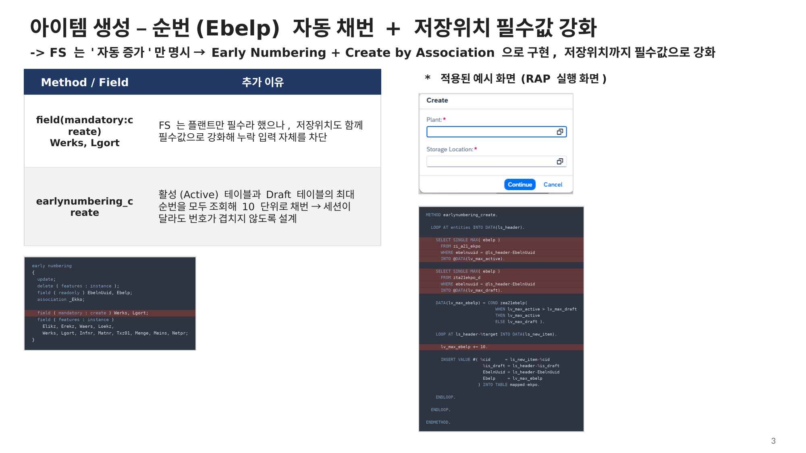
>
> 처음엔 저장할 때 번호를 채워 넣으면 될 거라고 생각했지만, RAP에서는 이미 만들어진 데이터의 키 값을 나중에 수정하는 것 자체가 불가능하다는 것을 알게 됐습니다. 품목번호(Ebelp)가 테이블의 키 값이라 저장 시점에 값을 바꾸는 방식이 허용되지 않았던 것입니다. 결국 Early Numbering + Create by Association 방식으로 바꿔서, 활성/Draft 테이블의 최댓값을 함께 조회해 세션이 달라도 번호가 겹치지 않도록 다시 설계했습니다.

### FI 계정관리 (Account Master)

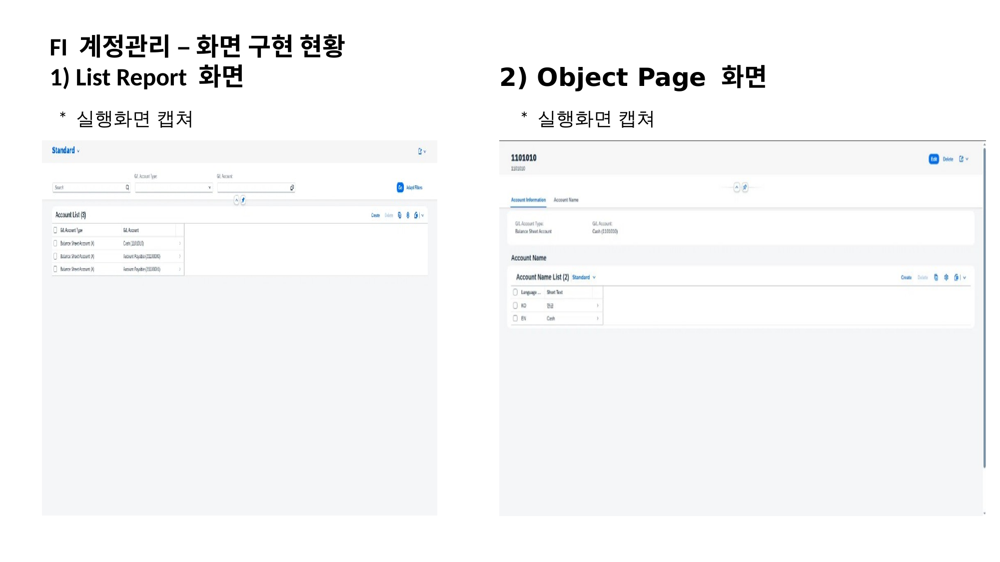

* 대차대조표·손익 등 계정유형별 G/L 계정 마스터 관리
* 현금·재고·매입채무·GR/IR 등 회계 업무에 사용할 G/L 계정을 계정유형별로 등록하고, 계정명을 다국어로 관리
* FS에 없던 XLOEV(사용중지) 필드를 신규 추가

### 회계계정결정관리 (Account Determination)

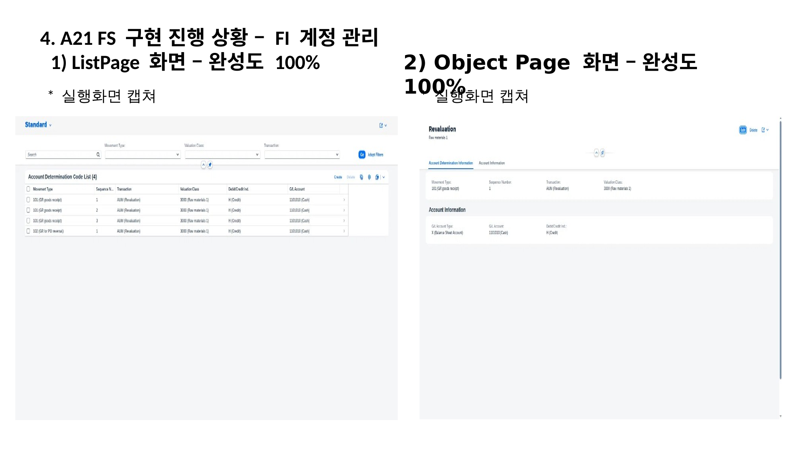

* 이동유형·거래키(BSX/WRX/PRD 등)·평가클래스 조합에 대응하는 G/L 계정을 사전에 정의해 두는 기준정보 관리
* 이동유형(Bwart)별로 순번(Seqnr)이 자동으로 이어지도록(최댓값+1) 채번 로직 구현

### 공통 적용 사항

프로그램마다 다르게 구현하지 않고, 아래 설계 원칙을 6개 프로그램에 동일하게 적용해 일관성을 유지했습니다.

* CDS 기반 Draft(V4 OData) / 비Draft(V2 OData) 시나리오 구현
* OData V4 환경에서는 UUID를 Key로 사용
* 표준 테이블을 참고해 필요한 필드만 골라 CBO 테이블로 구성
* Text 테이블(SPRAS) + `$session.system_language`로 자재명·계정명 다국어 자동 조회 - 전 프로그램 공통 적용
* 삭제 지시자(Lvorm/Loevm/Loekz) 체크 시 나머지 입력 가능 필드를 모두 Read-only 처리 - 전 프로그램 공통 적용
* LINK를 활용해 상위 엔티티의 삭제·비활성 상태를 하위 엔티티까지 실시간 전파(Feature Control)
* Number Range·Early Numbering을 활용한 자동 채번 (자재·공급업체·PIR·계정·구매오더)
* Side Effects로 저장 없이 즉시 필드 상태를 재평가하는 사용자 경험 구현
* Fiori Elements Value Help(F4 CDS) 연계로 플랜트·저장위치·자재유형 등 입력 편의성 확보
* 자재·공급업체 검색 도움말은 Interface View로 만들어 여러 프로그램에서 재사용
* 화면에 보일 필요가 없는 필드는 Metadata Extension의 `UI.hidden`으로 숨김 처리
* PIR → PO 등 프로그램 간 참조 연계 로직 및 필수값·참조무결성 검증 로직 구현

### 다국어 (EN↔KO) 처리

* 자재명·계정명 등 자유 텍스트는 SPRAS 키의 Text 테이블 + `$session.system_language`로 로그인 언어에 맞는 값을 자동 조회
* 자재유형 등 고정값 항목은 SAP 표준 도메인 텍스트를 SE63에서 번역해 자동 전환
* Validation 에러 메시지도 SE63 번역으로 동일하게 표시

---

## 2. SAP CODE 아카데미 ERP 프로젝트

8인 팀 프로젝트로, F&B(식자재) 유통 기업 '사계유통'의 구매·배송 업무를 SAP ERP로 구현했습니다. MM 쪽 ABAP 개발과 SD 쪽 Fiori/UI5 화면 개발을 맡았습니다.

| 구분    | 내용                                                            |
| ----- | ------------------------------------------------------------- |
| 개발기간  | 2026.03 ~ 2026.07 (SAP CODE 아카데미 1기)                          |
| 프로젝트명 | 사계유통 F&B 유통 ERP 구축 프로젝트                                       |
| 개발환경  | SAP GUI, ABAP, CDS View, Gateway/OData, Fiori/UI5, JavaScript |
| 개발인원  | 8명 (팀 프로젝트)                                                   |
| 담당역할  | MM 모듈 ABAP 개발, SD 영역 Fiori/UI5 화면 개발                          |

### 포장재 자동발주 프로그램

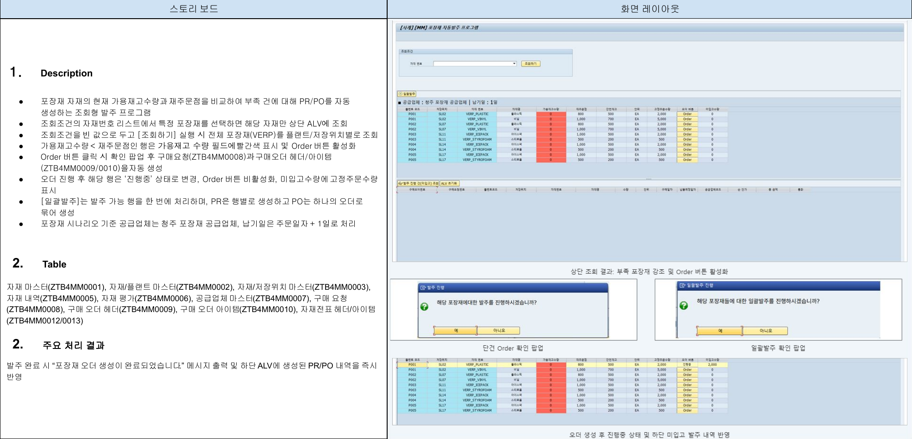

* 포장재 재고가 재주문점 아래로 내려가면 조회할 때 바로 강조해서 보여 주고, 담당자가 확인하면 구매요청(PR)과 구매오더(PO)가 자동으로 만들어지게 구현
* 발주는 하나씩 하는 방식(Order)과 전체를 한 번에 하는 방식(Order All) 두 가지로 제공

### 통합결재 프로그램

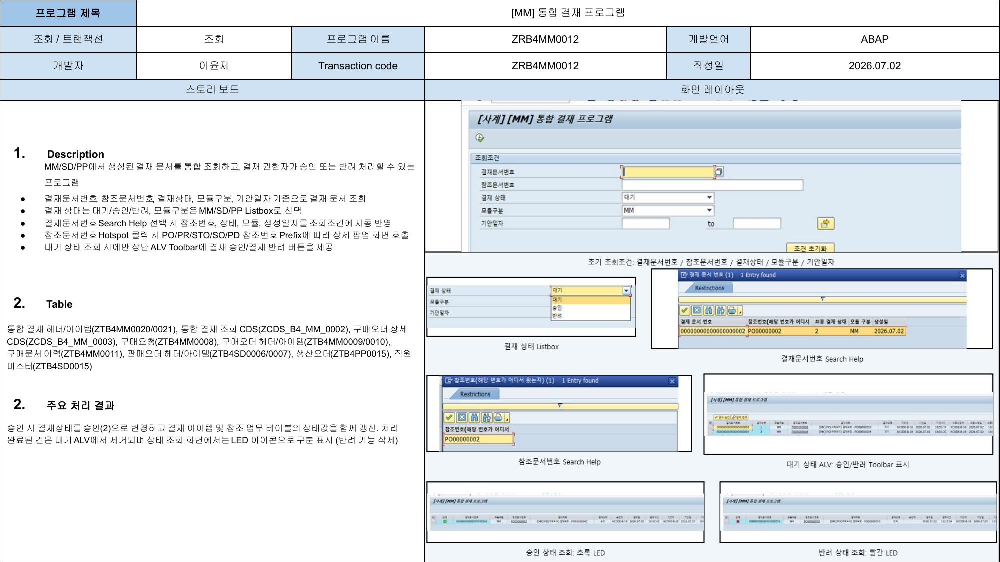

* MM/SD/PP에서 올라온 결재 문서를 한 화면에서 조회하고 승인/반려 처리
* 결재번호 채번과 참조문서 조회는 Function Module로 따로 만들고, 승인/반려 처리는 프로그램 안에서 직접 작성
* 참조문서번호를 누르면 문서 종류(PO/PR/STO/SO/PD)에 맞는 상세 팝업이 열림

### 구매오더 프로그램

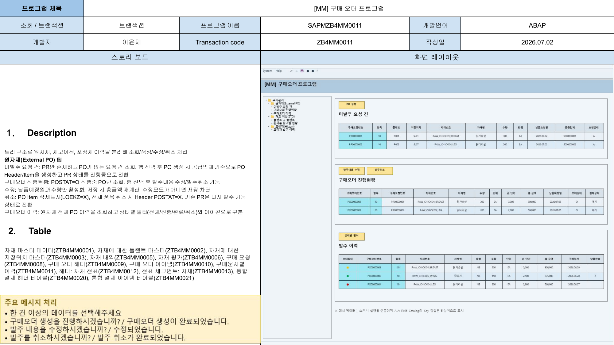

* 결재가 끝난 구매요청만 구매오더로 만들 수 있게 했고, 재고이전오더(STO)도 같은 화면에서 처리
* 원자재/재고이전/포장재 이력을 트리로 나누어 보여 주고, 각각 조회·생성·수정·취소 가능

### 입고 프로그램

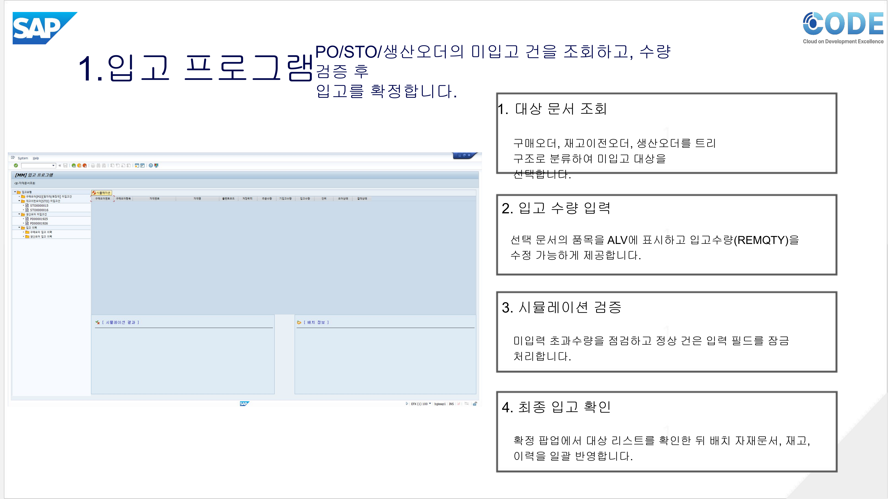

* 구매오더(PO)/재고이전오더(STO)/생산오더(PD)에서 아직 입고하지 않은 건을 트리로 조회해 입고 확정
* 입고할 때 배치번호를 부여하고, 부분입고와 오류 건 확인까지 처리

> **구현 노트 - 오류 건 확인**
>
> 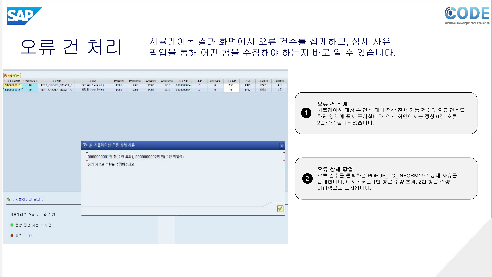
>
> 입고수량이 남은 수량 안에서만 입력되도록 확정 전에 먼저 검증하고, 검증을 통과한 행은 입력칸을 잠가 확정 전에 바뀌지 않게 했습니다. 오류가 난 행은 몇 번째 행이 어떤 이유(수량 초과, 미입력)인지 팝업으로 알려 줘서 입고 담당자가 무엇을 고쳐야 하는지 바로 알 수 있게 했습니다.

### 자재 유통기한 조회 프로그램

* 유통기한이 지난 자재를 조회하고 폐기 처리까지 처리

### 모바일 배송기사 앱 (Fiori/UI5)

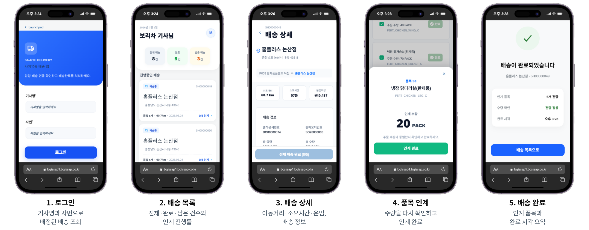

* 기사 로그인부터 품목 인계, 전체 배송 완료까지 모바일 화면에서 처리하는 배송기사 앱 개발
* 모든 품목을 인계해야 전체 배송 완료 버튼을 쓸 수 있게 했고, 품목별 인계 상태는 화면을 다시 열어도 유지

### 사계유통 주문 · 배송 관리 (Fiori/UI5)

* 고객 주문을 입력하면 내용을 검증해 Excel로 이메일 발송하는 화면과, 배송 현황과 운임을 조회하는 화면 개발
* 거래처와 자재는 검색 도움말로 고르게 했고, 필수 항목이 비었거나 수량이 0 이하이면 발송을 막음

**사계유통 주문 프로그램** - 주문 등록, 거래처·자재 검색 도움말, 입력 검증, Excel 이메일 발송

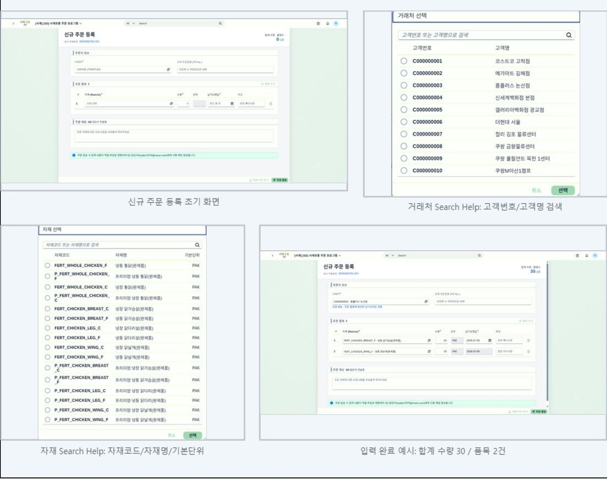

**배송 관리 프로그램** - 조회 조건 선택, 배송 건수·이동거리·소요시간·예상 운임 집계

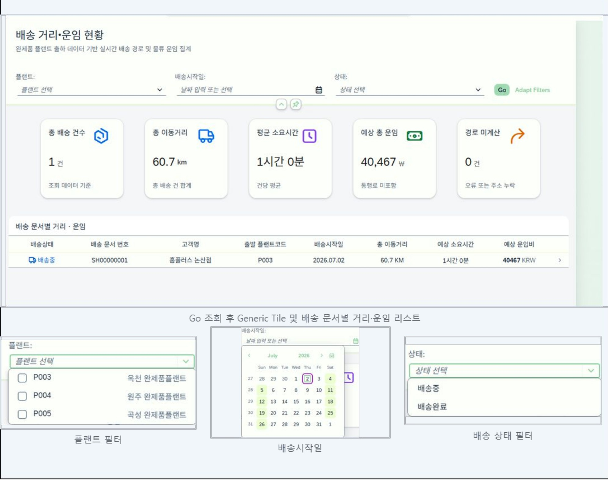

---

## 3. Calogram - 영양분석 식단관리 애플리케이션

| 구분    | 내용                                                |
| ----- | ------------------------------------------------- |
| 개발기간  | 2022.03 ~ 2022.05                                 |
| 프로젝트명 | 칼로그램                                              |
| 개발환경  | Android Studio, Java, Firebase, OpenCV, Tesseract |
| 개발인원  | 4명                                                |
| 담당역할  | 운동 화면 및 칼로리 계산 기능 개발                              |

### 담당 기능

* 운동 화면 개발
* 남은 칼로리 및 태운 칼로리 출력
* METS 공식을 활용한 운동 칼로리 자동 계산 기능 구현
* 섭취 칼로리와 운동 칼로리를 비교할 수 있는 그래프 개발

---

## 4. Budget Management Work(BMW)

| 구분    | 내용                                                  |
| ----- | --------------------------------------------------- |
| 개발기간  | 2021.03.09 ~ 2021.07.01                             |
| 프로젝트명 | Budget Management Work                              |
| 개발환경  | Android Studio, Java, SQLite, Jira Software, GitHub |
| 개발인원  | 4명                                                  |
| 담당역할  | 로그인/회원가입 및 데이터베이스 관리                                |

### 담당 기능

* 로그인 기능 구현
* 회원가입 기능 구현
* SQLite를 활용한 사용자 데이터 관리

---

## 5. 다이어리 프로젝트

| 구분    | 내용                    |
| ----- | --------------------- |
| 개발기간  | 2021.03 ~ 2021.06     |
| 프로젝트명 | 다이어리 프로젝트             |
| 개발환경  | Eclipse, Java, GitHub |
| 개발인원  | 3명                    |
| 담당역할  | 로그인 및 검색/수정 기능 개발     |

### 담당 기능

* 로그인 화면 구현
* 회원가입 기능 구현
* 암호변경 기능 구현
* 검색 및 수정 기능 일부 구현

---

## 6. 부루마블 게임

| 구분    | 내용                |
| ----- | ----------------- |
| 개발기간  | 2020.03 ~ 2020.06 |
| 프로젝트명 | 부루마블 게임           |
| 개발환경  | Visual Studio, C  |
| 개발인원  | 4명                |
| 담당역할  | 게임 진행 로직 개발       |

### 담당 기능

* 플레이어 이름 설정
* 현재 턴 표시
* 주사위 굴리기 기능
* 플레이어 차례 표시
* 주사위 진행 결과에 따른 시나리오 출력

---

## 사용 기술 요약

### SAP

* ABAP
* RAP (Managed, V2/V4 OData)
* CDS View
* OData V2 / V4, Gateway/OData
* Fiori/UI5, Fiori Elements

### 설계 패턴

* Draft
* Composition
* Number Range
* Early Numbering
* Feature Control
* Side Effects

### Web/App

* Java
* JavaScript
* SQL
* Android Studio
* Firebase
* SQLite

### Tool

* SAP GUI
* SAP BTP ABAP Environment
* ADT (Eclipse)
* Business Application Studio
* VS Code
* Eclipse
* Visual Studio
* GitHub
